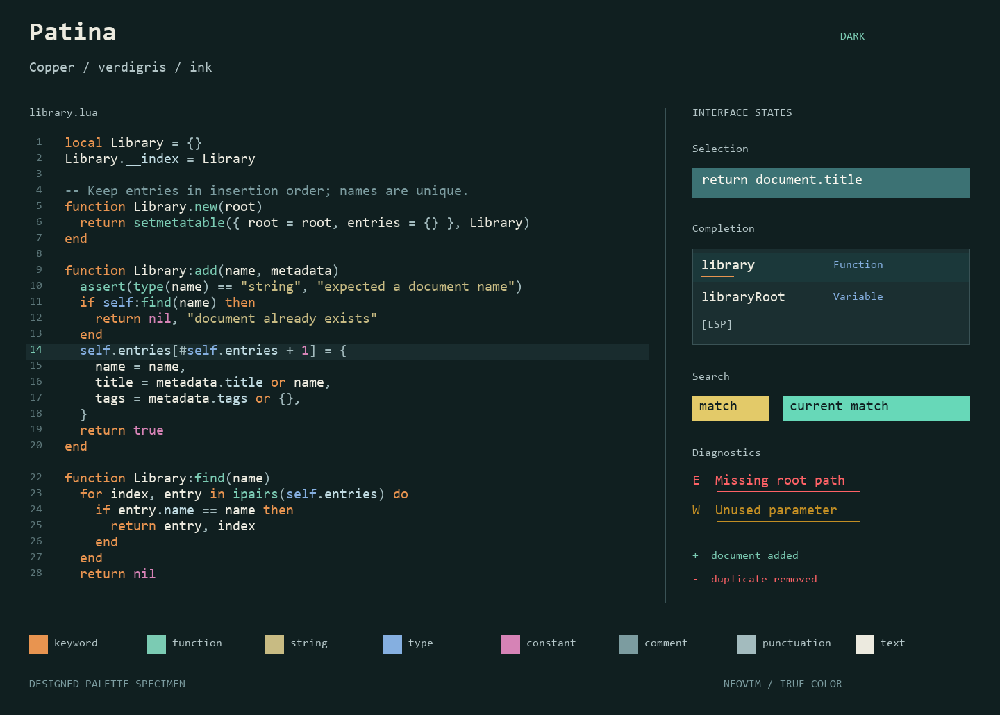
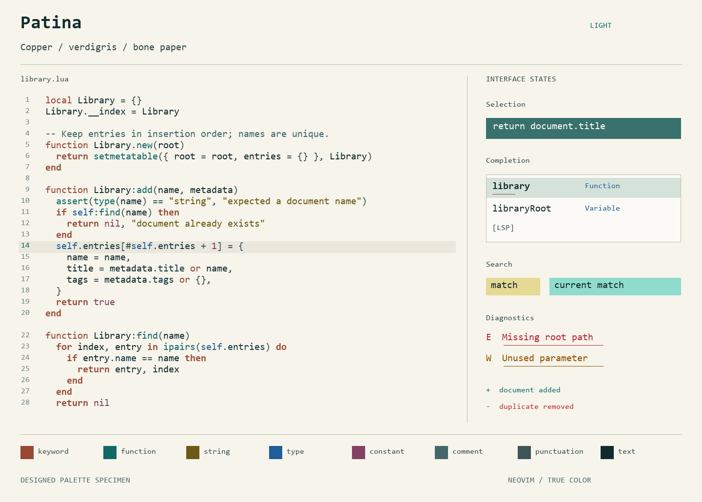

# Patina

Copper keywords, verdigris functions, and room to read. A dark and light colorscheme for Neovim, with matching Kitty, Alacritty, and Ghostty themes.




These are designed palette specimens. CI also renders Neovim's actual screen cells for code, selection, completion, diagnostics, search, and diffs; download them from the **Verify** workflow's artifacts.

## Install

Neovim 0.10.4 or newer, with a terminal that supports true color.

With lazy.nvim:

```lua
{
  "librerob/patina.nvim",
  lazy = false,
  priority = 1000,
  config = function()
    vim.o.background = "dark" -- or "light"
    vim.cmd.colorscheme("patina")
  end,
}
```

For a manual installation, clone the **whole repository** into your Neovim package directory:

```sh
git clone https://github.com/librerob/patina.nvim.git \
  ~/.config/nvim/pack/themes/start/patina.nvim
```

On Windows, the corresponding directory is `~/AppData/Local/nvim/pack/themes/start/patina.nvim`. Then add `vim.cmd.colorscheme("patina")` to your configuration. Changing `background` switches variants live.

## Options

Setup is optional. Call it before loading the colorscheme:

```lua
require("patina").setup({
  italic_comments = false,
  bold_control_flow = true, -- light mode: conditionals, loops, returns, exceptions
  overrides = {},
})
vim.cmd.colorscheme("patina")
```

`overrides` accepts highlight definitions or a function returning them:

```lua
require("patina").setup({
  overrides = function(colors)
    return { Comment = { fg = colors.comment, italic = true } }
  end,
})
```

Read a copy of either palette with `require("patina").palette("light")` or `palette("dark")`. Calling `setup()` again resets unspecified options to their defaults and reapplies the active theme.

## Editor support

Vim syntax, Treesitter, LSP semantic tokens and diagnostics, Telescope, which-key, nvim-cmp, blink.cmp, neo-tree, gitsigns, indent-blankline, and lualine have highlight definitions. Plugin-specific rendering depends on the plugin's configuration; the live UI regression tests exercise Neovim's built-in completion menu.

For lualine:

```lua
require("lualine").setup({ options = { theme = "patina" } })
```

Visual selection uses a dedicated foreground/background pair. Selected code becomes one readable ink color. Completion menus keep their syntax and kind colors on a separate, quieter selected surface. Light mode adds bold to control flow; declarations retain normal weight.

## Terminal themes

- **Kitty:** include `ports/kitty/patina-dark.conf` or `patina-light.conf` from your configuration.
- **Alacritty:** import the matching TOML file from `ports/alacritty/` in `[general].import`.
- **Ghostty:** copy `ports/ghostty/Patina Dark` and `Patina Light` into your Ghostty `themes` directory, then set `theme = Patina Dark` or `theme = Patina Light`.

Terminal themes are static files; switch their variants separately from Neovim.

## Development

The JSON files in `palette/` are the source for the generated Lua palette and all terminal ports.

```sh
python tools/build.py
python tools/build.py --check
python tests/contrast.py
nvim --headless -u NONE -l tests/highlights.lua
python -m pip install pillow msgpack
python tests/ui.py
python tools/preview.py
```

Python checks require 3.11+. CI runs the theme and UI tests on Neovim 0.10.4 and stable. See [testing notes](docs/TESTING.md) for scope and limitations, and [design notes](docs/DESIGN.md) for the palette decisions.

MIT licensed.
