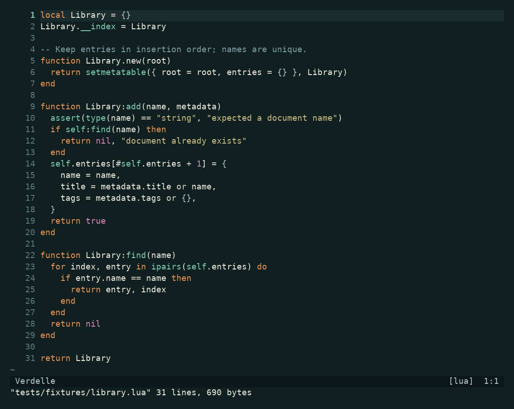
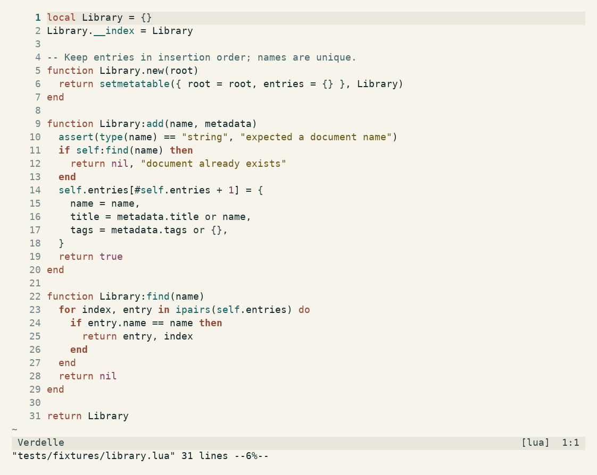

<p align="center">
  <picture>
    <source media="(prefers-color-scheme: dark)" srcset="assets/sprout-dark.svg">
    <source media="(prefers-color-scheme: light)" srcset="assets/sprout-light.svg">
    
  </picture>
</p>

<h1 align="center">Verdelle</h1>

<p align="center">Copper and verdigris, on ink and paper.<br>A dark and light colorscheme for editors and terminals.</p>

<p align="center"><strong>Dark</strong> · deep teal, copper keywords, and soft brass strings.</p>



<p align="center"><strong>Light</strong> · bone paper, terracotta keywords, and verdigris functions.</p>



Previews render Neovim's actual screen cells with the built-in Lua syntax. They are not terminal screenshots. [Palette and interface specimens](docs/PREVIEWS.md).

## Install

### Neovim

Neovim 0.10.4+ and a truecolor terminal. With lazy.nvim:

```lua
{
  "librerob/verdelle",
  lazy = false,
  priority = 1000,
  config = function()
    vim.o.background = "dark" -- or "light"
    vim.cmd.colorscheme("verdelle")
  end,
}
```

For a manual install, copy `colors/verdelle.lua` and `lua/` into the corresponding directories in `vim.fn.stdpath("config")`.

Verdelle follows `background`. Switch with `:set background=light` or `:set background=dark`.

Setup is optional, before loading the theme:

```lua
require("verdelle").setup({
  italic_comments = false,
  bold_control_flow = true, -- light mode
})
```

Includes Vim syntax, Treesitter, LSP, diagnostics, diffs, and terminal colors. There are highlight mappings for Telescope, which-key, blink.cmp, nvim-cmp, neo-tree, gitsigns, and indent-blankline. Plugins and language parsers are installed separately. For lualine, set `options.theme = "verdelle"`.

### Terminals

| App | Dark | Light | Setup |
| --- | --- | --- | --- |
| Kitty | [verdelle-dark.conf](ports/kitty/verdelle-dark.conf) | [verdelle-light.conf](ports/kitty/verdelle-light.conf) | Include your chosen file after other color settings. |
| Alacritty | [verdelle-dark.toml](ports/alacritty/verdelle-dark.toml) | [verdelle-light.toml](ports/alacritty/verdelle-light.toml) | Add your chosen file to the existing `[general]` import array. |
| Ghostty | [Verdelle Dark](ports/ghostty/Verdelle%20Dark) | [Verdelle Light](ports/ghostty/Verdelle%20Light) | Copy to your Ghostty `themes` directory, then set `theme = Verdelle Dark` or `theme = Verdelle Light`. |

These files set terminal colors. Editor syntax highlighting needs the editor theme too. Terminal variants switch separately from Neovim.

## Colors

Copper marks keywords, verdigris marks functions, and brass marks strings. Ordinary text stays neutral. Light mode uses the same warm/cool relationship on bone paper, with a little extra weight for control-flow groups.

Selection has its own readable foreground and stronger teal background. Completion uses a quieter surface so matched text, kind labels, and source labels remain visible.

The checks cover **252 text/background pairs**, all at least **4.5:1**, including comments, diffs, search, and completion states. Selected text exceeds **5:1** in both variants. Passive borders, whitespace, and line numbers are deliberate exceptions.

[Dark palette](palette/dark.json) · [Light palette](palette/light.json) · [Design notes](docs/DESIGN.md)

## Development

`palette/dark.json` and `palette/light.json` are the sources for the Lua palette and terminal ports. With Python 3.11+:

```sh
python tools/build.py
python tools/build.py --check
python tests/contrast.py
nvim --headless -u NONE -l tests/highlights.lua
```

CI also runs a real Neovim UI on 0.10.4 and stable, checking selection, completion, diagnostics, search, diffs, and live switching. See [test coverage and limits](docs/TESTING.md). [Configuration and overrides](docs/CONFIGURATION.md).

## License

[MIT](LICENSE).
