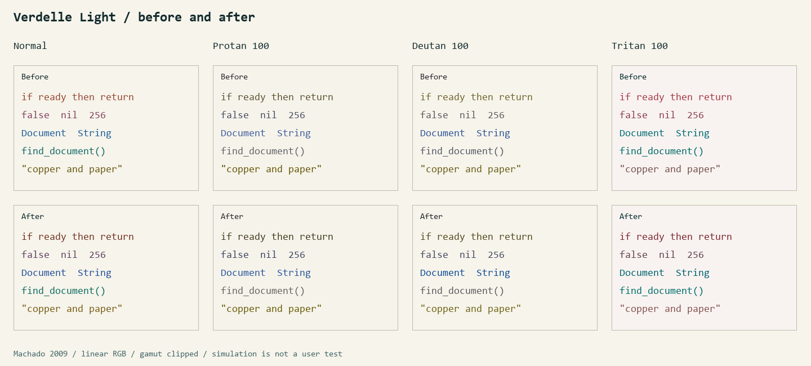

# Color-vision checks

The light palette was revised after measuring the original published colors. Dark was retained: its copper keyword/mint function pair was already well separated under the simulations, and changing it merely to satisfy a color-name rule was not justified.

| Light role | Before | After | Base contrast, after |
| --- | --- | --- | --- |
| Keyword | `#984733` | `#733323` | 8.56:1 |
| Constant | `#844161` | `#604061` | 7.93:1 |
| Type | `#215D99` | `#255098` | 7.11:1 |
| Function | `#136866` | `#0E6C5F` | 5.73:1 |
| String | `#6C5914` | `#7A5C15` | 5.66:1 |

The lightest accent still passes 4.5:1 on all nine tested editor surfaces. The lightness range of the five accents increased from about 3.3 to 11.2 CIELAB L* units. The last two roles remain close in lightness but occupy different warm/cool hue families. Bold control flow is now off by default; it remains available as an option.

Across the tested simulations, the weakest light pair increased from **4.51 to 9.22 CIEDE2000**. The original weak pairs were keyword/string under full deutan simulation and function/type under full tritan simulation. The revised minimum is function/type under full tritan simulation. These numbers summarize the weakest pair, not an improvement of every individual pair in every scenario. The complete [before/after report](colorvision-report.json) includes all distances.

The unchanged dark palette's minimum is **7.36**, for function/type under full tritan simulation. Its keyword/function distance never falls below **19.70** in the tested scenarios. This is a remaining design tradeoff; the report does not hide it behind an all-purpose pass label.



## Method

Five chromatic syntax roles are compared: keyword, constant, type, function, and string. Their ten pairs are measured under normal vision and the Machado model's published protan, deutan, and tritan matrices at severities 10–100 in steps of 10. That is 620 pair/scenario comparisons across the two variants for each palette version.

Colors are decoded from sRGB to linear RGB, transformed, clipped to the display gamut, converted to CIELAB with a D65 reference white, and compared with CIEDE2000 using unit parametric factors. Clipping is explicit because these are displayed-color comparisons, not distances between out-of-gamut coordinates. The CIEDE2000 implementation is tested against all 34 supplementary reference vectors published by Sharma, Wu, and Dalal, including the hue-boundary cases.

The original palette is frozen at [tests/fixtures/palette-v1.json](../tests/fixtures/palette-v1.json), from commit `d0e2256eeb1ae88d43e32647dd171fc0d4a1921f`. Run:

```sh
python tests/color_math_test.py
python tools/colorvision.py --check
```

To regenerate the report and illustration:

```sh
python tools/colorvision.py
python -m pip install pillow
python tools/vision_preview.py
```

The regression bounds are 9.0 for the revised light palette and 7.3 for the retained dark palette. They guard the chosen design against accidental collisions; they are not clinical or accessibility standards. The tests do not require every role pair to exceed an arbitrary 15, and they do not claim universal colorblind safety. Neutral punctuation/comments and diagnostic severities have separate purposes and are not included in the five-role minimum. Diagnostics retain severity labels, signs, and underlines.

Simulations do not replace feedback from people with color-vision deficiencies. Font rendering, terminal opacity, individual differences, ambient light, and sustained comfort remain outside these calculations.

Sources: [Machado, Oliveira, and Fernandes, 2009](https://doi.org/10.1109/TVCG.2009.113); [published numerical matrices as reproduced by Colorspacious](https://github.com/njsmith/colorspacious/blob/master/colorspacious/cvd.py); [Sharma, Wu, and Dalal reference data](https://hajim.rochester.edu/ece/sites/gsharma/ciede2000/).
