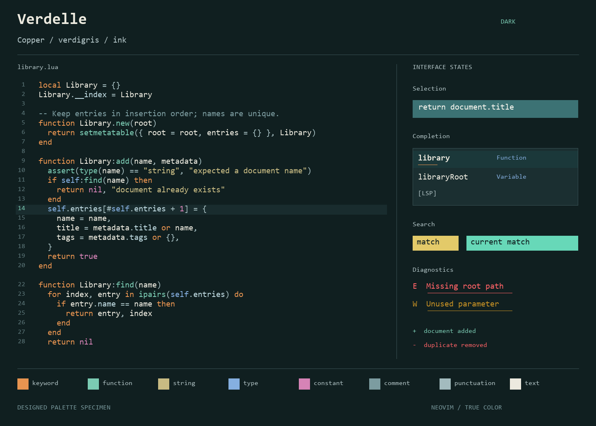
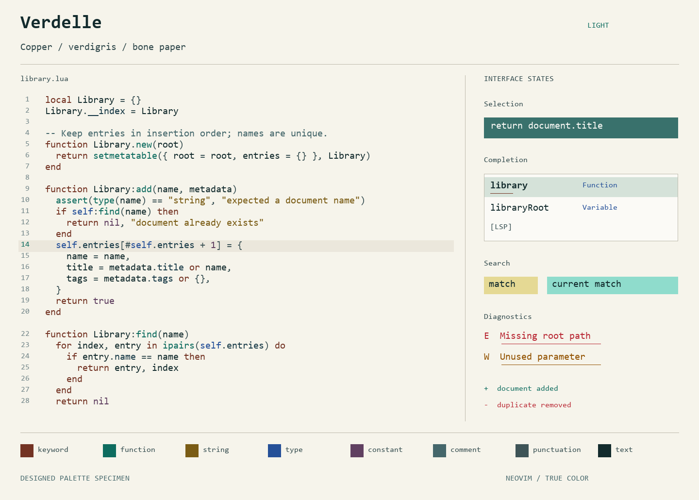

# Previews

The README code views come from a real Neovim session in CI. `tests/ui.py` renders the RGB screen cells with Pillow and DejaVu Sans Mono. It uses Neovim's built-in Lua syntax, with no Treesitter parser or language server installed. Token classification can differ with Treesitter or LSP.

The complete set of captures is available in the Verify workflow artifacts: Lua, Python, TypeScript, Rust, JSON, Markdown, selection, completion, diagnostics, search, and diffs, in both variants. The Kitty artifact contains actual terminal screenshots of both generated themes.

These designed specimens show the palette and individual interface states:

Regenerate the specimens with `python tools/preview.py`. They are illustrations of the configured colors rather than a live editor session.
